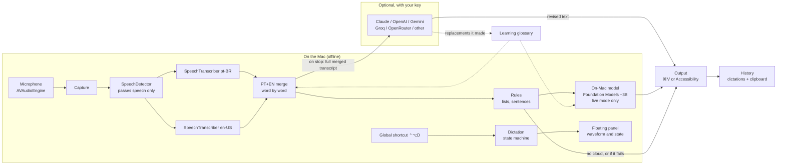
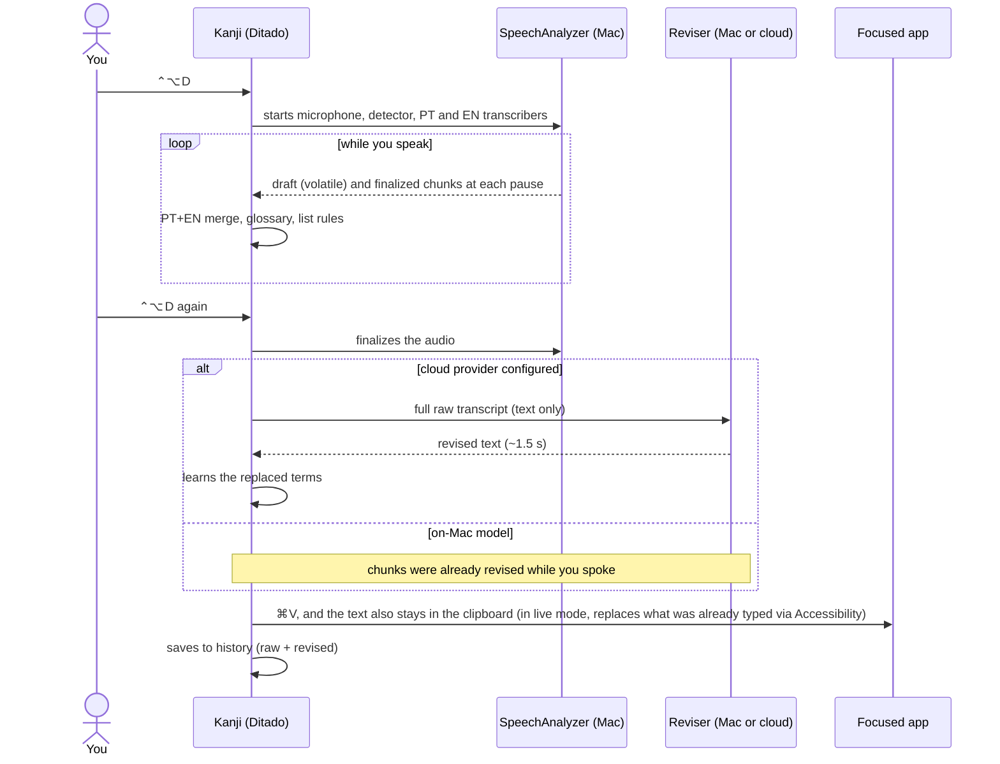

# Kanji architecture

English · [Português (Brasil)](ARCHITECTURE.pt-BR.md)

How audio becomes polished text in the app you're using. The diagrams use Mermaid, which GitHub renders on its own.

## In one sentence

The microphone feeds Apple's speech recognizer, which runs on the Mac in Portuguese and English at the same time. The two results are merged word by word, deterministic rules handle lists and sentences, and a language model revises the text (the on-Mac one, or a cloud one with your key). The result is pasted where the cursor is.

## Overview

## The layers

| Layer | Files | Technology | What it does |
|---|---|---|---|
| Input | `Atalho.swift` | Carbon `RegisterEventHotKey` | Global shortcuts: dictate, open, cancel (esc) |
| Orchestration | `Ditado.swift` | `@Observable`, Swift Concurrency | Phases: preparing → recording → adjusting → done. Ordered chunk queue |
| Audio and speech | `Captura.swift` | `AVAudioEngine`, `SpeechAnalyzer` | Microphone → voice detector → two transcribers. Measures volume for the waveform and to find pauses |
| Merge | `Fusao.swift` | word timing, confidence, `NSSpellChecker`, `NLTagger` | Picks, word by word, between Portuguese and English. Applies the glossary and removes mid-sentence capitals |
| Rules | `Revisao.swift` | Plain Swift (tested) | Dictated lists, joining sentences split by a pause |
| Local model | `Correcao.swift` | Foundation Models (Apple Intelligence) | Corrects one chunk at a time, with a faithfulness guard |
| Cloud model | `Nuvem.swift` | `URLSession` + Keychain | Revises the whole dictation: Anthropic Messages or OpenAI Chat Completions format |
| Learning | `Aprendizado.swift` | `CollectionDifference` | Compares what went in with what the cloud returned and learns terms |
| Output | `Saida.swift`, `Alvo.swift` | `CGEvent` (⌘V), Accessibility API | Pastes into the focused app or types live into the field |
| Interface | `Painel.swift`, `AjustesView.swift`, `PrimeirosPassos.swift`, `HistoricoView.swift` | SwiftUI + `NSPanel` | Panel that doesn't steal focus, Settings, onboarding, history |
| Data | `Historico.swift` | JSON in Application Support | Dictations and clipboard (polling `changeCount`); ignores passwords and keys |

## One dictation, step by step

## The two typing modes

| | Only at the end (default with cloud) | While you speak (default without cloud) |
|---|---|---|
| While speaking | The panel only shows the waveform | Each revised chunk goes into the field via Accessibility |
| Who revises | The cloud model, with the whole text | The on-Mac model, chunk by chunk |
| On stop | Pastes the final text | Replaces only the part that changed |
| Why it exists | Better quality, ~2 s after stopping | Instant response, offline |

Pasting with ⌘V works in any app. Typing via Accessibility doesn't: web and Electron editors (the Claude chat, for example) answer "ok" and ignore the text. That's why "only at the end" mode always pastes.

## The models

### Speech recognition: `SpeechAnalyzer` (Apple)
- Runs on the Mac. Each language's models are downloaded by the system (`AssetInventory`) and shared across apps: Kanji doesn't bundle any model.
- **`SpeechDetector`:** voice detector. Without it, silence and noise turned into words ("Não.", "Oh.").
- **Two `SpeechTranscriber`s on the same audio.** The Portuguese one sends volatile results (the gray draft in the panel) and finalized ones. The English one sends only finalized results, with each word's timing, for the merge.
- **Pauses:** when volume drops for 0.35 s after speech, Kanji asks the recognizer to finalize the chunk. That way text isn't held back for 10 s.

### On-Mac model: Foundation Models (Apple Intelligence)
- A ~3B-parameter language model that ships with the system. Free, offline, 8,192-token context.
- **What it receives:**
  - instructions = fixed rules + the person's style + the glossary;
  - prompt = the last 300 characters already typed (context only) + the new chunk.
- **How it responds:** *guided generation*, a schema with a single field, `trecho`, which stops the model from commenting or repeating the context. *Greedy* decoding, so the same input always gives the same output, and a token cap, because *greedy* sometimes loops.
- **Faithfulness guard:** if the model translated, cut or invented words, the revision is discarded and the chunk stays as it came in. A 3B model does this often, especially with English.

### Cloud model (optional)
- **What it receives:**
  - *system* = correction rules (never translate, lists in the requested order, don't answer the content) + style + glossary;
  - *user* = `<transcricao>…</transcricao>`.
  
  The transcript goes **as data, never as a request**: a dictation that says "revise this for me" doesn't turn into a conversation with the model.
- **Formats:** Anthropic Messages for Claude (`claude-haiku-5-5`, reasoning off, low effort) and Chat Completions for the others. "OpenAI-compatible" became the industry standard: a single client covers OpenAI, Gemini, Groq and OpenRouter.
- **Safeguards:**
  - the timeout grows with the dictation's length (15 s minimum), because dictation has no length limit;
  - HTTPS only (HTTP only for localhost), so the key and text don't travel in the clear;
  - a response much shorter or longer than the dictation is discarded.
- **If it fails,** the panel shows an orange warning and the local text is used: in live mode, revised by the on-Mac model; in "only at the end" mode, the merged transcript with the local rules (lists, glossary).
- **The key** belongs to the user, stored in the Keychain, one per provider. Kanji has no server and no key of its own.

### Learning glossary
At the end of each cloud revision, Kanji compares the raw transcript with the returned text:
1. A sequence diff (`CollectionDifference`) finds the replaced spans.
2. Only short replacements count, where the new term is not a Portuguese word (jargon, brand) or is a capitalized name mid-sentence.
3. Accent, capitalization or punctuation fixes don't count.

The second time the same term shows up, it goes into the glossary. From then on it applies in the merge, the rules and the on-Mac model, offline. The list lives in *Ajustes › Correção* (Settings › Correction), where you can forget a term.

## Security and privacy

- Audio never leaves the Mac. Only text goes to the cloud, and only with the key the person set up.
- API keys are stored in the Keychain, never in code or in `UserDefaults`.
- Clipboard history ignores:
  - items flagged as passwords by password managers (nspasteboard.org convention);
  - any text that looks like a key or token.
- Logs (`os.Logger`) don't record dictation content.

## Open tools used

Apple frameworks only:
- `SpeechAnalyzer` / `Speech`, `FoundationModels`, `AVFoundation`, `NaturalLanguage`, `AppKit` / `SwiftUI`, `Security` (Keychain), `ApplicationServices` (Accessibility);
- `Accelerate` (audio volume);
- `Carbon` (global shortcuts).

No third-party dependencies, no model downloaded by the app.

## Known limitations

- Requires macOS 27 and Apple Silicon; local correction requires Apple Intelligence.
- The on-Mac model doesn't understand the whole text: lists in the requested order and terms that are wrong in context need a cloud model.
- Typing live via Accessibility doesn't work in web and Electron editors. In those apps, the text is pasted at the end.
- No diarization (who said what) and no system audio capture for now: see the [ROADMAP](ROADMAP.md).
