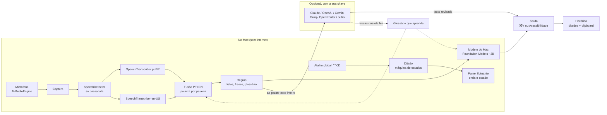
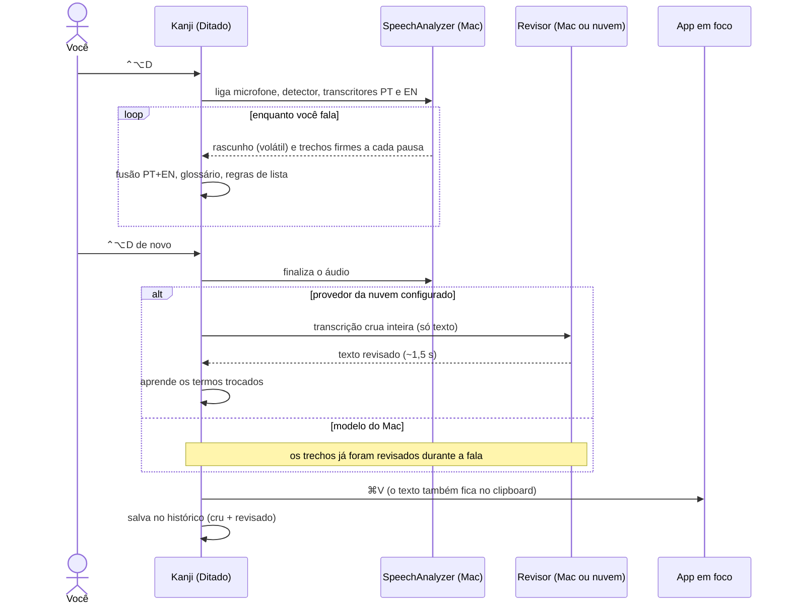

# Arquitetura do Kanji

Como o áudio vira texto revisado no app em que você está. Os diagramas usam Mermaid, que o GitHub desenha sozinho.

## Em uma frase

O microfone alimenta o reconhecedor de fala da Apple, que roda no próprio Mac em português e em inglês ao mesmo tempo. Os dois resultados são fundidos palavra por palavra, regras determinísticas cuidam de listas e frases, e um modelo de linguagem revisa o texto (o do Mac, ou um da nuvem com a sua chave). O resultado é colado onde está o cursor.

## Visão geral

## As camadas

| Camada | Arquivos | Tecnologia | O que faz |
|---|---|---|---|
| Entrada | `Atalho.swift` | Carbon `RegisterEventHotKey` | Atalhos globais: ditar, abrir, cancelar (esc) |
| Orquestração | `Ditado.swift` | `@Observable`, Swift Concurrency | Fases: preparando → gravando → ajustando → pronto. Fila de trechos em ordem |
| Áudio e fala | `Captura.swift` | `AVAudioEngine`, `SpeechAnalyzer` | Microfone → detector de voz → dois transcritores. Mede o volume para a onda e para achar pausas |
| Fusão | `Fusao.swift` | tempo das palavras, confiança, `NSSpellChecker`, `NLTagger` | Escolhe, palavra por palavra, entre o português e o inglês. Aplica o glossário e tira maiúscula no meio da frase |
| Regras | `Revisao.swift` | Swift puro (testado) | Listas ditadas, junção de frases cortadas por pausa |
| Modelo local | `Correcao.swift` | Foundation Models (Apple Intelligence) | Corrige um trecho por vez, com uma trava de fidelidade |
| Modelo da nuvem | `Nuvem.swift` | `URLSession` + Keychain | Revisa o ditado inteiro: formato Anthropic Messages ou OpenAI Chat Completions |
| Aprendizado | `Aprendizado.swift` | `CollectionDifference` | Compara o que entrou com o que a nuvem devolveu e aprende termos |
| Saída | `Saida.swift`, `Alvo.swift` | `CGEvent` (⌘V), API de Acessibilidade | Cola no app em foco ou escreve ao vivo no campo |
| Interface | `Painel.swift`, `AjustesView.swift`, `PrimeirosPassos.swift`, `HistoricoView.swift` | SwiftUI + `NSPanel` | Painel que não rouba o foco, Ajustes, onboarding, histórico |
| Dados | `Historico.swift` | JSON em Application Support | Ditados e clipboard (polling do `changeCount`); ignora senhas e chaves |

## Um ditado, passo a passo

## Os dois modos de escrita

| | Só no fim (padrão com nuvem) | Enquanto fala (padrão sem nuvem) |
|---|---|---|
| Durante a fala | O painel mostra só a onda | Cada trecho revisado entra no campo pela Acessibilidade |
| Quem revisa | O modelo da nuvem, com o texto inteiro | O modelo do Mac, trecho a trecho |
| Ao parar | Cola o texto final | Troca só o pedaço que mudou |
| Por que existe | Melhor qualidade, ~2 s depois de parar | Resposta imediata, sem internet |

A colagem com ⌘V funciona em qualquer app. A escrita pela Acessibilidade não: editores web e Electron (o chat do Claude, por exemplo) respondem "ok" e ignoram o texto. Por isso o modo "só no fim" sempre cola.

## Os modelos

### Reconhecimento de fala: `SpeechAnalyzer` (Apple, macOS 26+)
- Roda no Mac. Os modelos de cada idioma são baixados pelo sistema (`AssetInventory`) e compartilhados entre apps: o Kanji não empacota nenhum modelo.
- **`SpeechDetector`:** detector de voz. Sem ele, silêncio e ruído viravam palavras ("Não.", "Oh.").
- **Dois `SpeechTranscriber` no mesmo áudio.** O de português manda resultados voláteis (o rascunho cinza do painel) e firmes. O de inglês só manda os firmes, com o tempo de cada palavra, para a fusão.
- **Pausas:** quando o volume cai por 0,35 s depois de fala, o Kanji pede ao reconhecedor para firmar o trecho. Assim o texto não fica preso por 10 s.

### Modelo do Mac: Foundation Models (Apple Intelligence)
- Um modelo de linguagem de ~3B parâmetros, que vem com o sistema. Grátis, sem internet, contexto de 8.192 tokens.
- **O que recebe:**
  - instruções = regras fixas + o estilo da pessoa + o glossário;
  - prompt = os últimos 300 caracteres já escritos (só contexto) + o trecho novo.
- **Como responde:** *guided generation*, um esquema com um campo só, `trecho`, que impede o modelo de comentar ou repetir o contexto. Decodificação *greedy*, para a mesma entrada dar sempre a mesma saída, e teto de tokens, porque o *greedy* às vezes entra em loop.
- **Trava de fidelidade:** se o modelo traduziu, cortou ou inventou palavras, a revisão é descartada e fica o trecho como veio. Um modelo de 3B faz isso com frequência, principalmente com inglês.

### Modelo da nuvem (opcional)
- **O que recebe:**
  - *system* = regras de revisão (nunca traduzir, listas na ordem pedida, não responder ao conteúdo) + estilo + glossário;
  - *user* = `<transcricao>…</transcricao>`.
  
  A transcrição vai **como dado, nunca como pedido**: um ditado que diz "revisa isso pra mim" não vira uma conversa com o modelo.
- **Formatos:** Anthropic Messages para o Claude (`claude-haiku-5-5`, raciocínio desligado, esforço baixo) e Chat Completions para os outros. "Compatível com OpenAI" virou o padrão da indústria: um cliente só cobre OpenAI, Gemini, Groq e OpenRouter.
- **Proteções:** timeout de 15 s; resposta muito menor ou maior que o ditado é descartada. Em qualquer falha, fica a revisão local e o painel avisa em laranja.
- **A chave** é do usuário, guardada no Keychain, uma por provedor. O Kanji não tem servidor nem chave própria.

### Glossário que aprende
Ao final de cada revisão da nuvem, o Kanji compara a transcrição crua com o texto devolvido:
1. Uma diferença de sequência (`CollectionDifference`) acha os trechos trocados.
2. Contam só as trocas curtas por um termo que não é palavra do português (jargão, marca) ou por um nome com maiúscula no meio da frase.
3. Correção de acento, maiúscula ou pontuação não conta.

Na segunda vez que o mesmo termo aparece, ele entra no glossário. A partir daí vale na fusão, nas regras e no modelo do Mac, sem internet. A lista fica em Ajustes › Correção, onde dá para esquecer um termo.

## Segurança e privacidade

- O áudio nunca sai do Mac. Para a nuvem vai só o texto, e só com a chave que a pessoa configurou.
- Chaves de API ficam no Keychain e nunca no código ou no `UserDefaults`.
- O histórico do clipboard ignora:
  - itens marcados como senha pelos gerenciadores (convenção nspasteboard.org);
  - qualquer texto com cara de chave ou token.
- Os logs (`os.Logger`) não registram o conteúdo dos ditados.

## Ferramentas abertas usadas

Só frameworks da Apple:
- `SpeechAnalyzer` / `Speech`, `FoundationModels`, `AVFoundation`, `NaturalLanguage`, `AppKit` / `SwiftUI`, `Security` (Keychain), `ApplicationServices` (Acessibilidade);
- `Accelerate` (volume do áudio);
- `Carbon` (atalhos globais).

Nenhuma dependência de terceiros, nenhum modelo baixado pelo app.

## Limites conhecidos

- Exige macOS 27 e Apple Silicon; a revisão local exige Apple Intelligence.
- O modelo do Mac não entende o texto inteiro: listas na ordem pedida e termos errados pelo contexto pedem um modelo da nuvem.
- Escrever ao vivo pela Acessibilidade não funciona em editores web e Electron. Nesses apps, o texto entra colado no fim.
- Sem diarização (quem falou o quê) e sem captura do áudio do sistema por enquanto: veja o [ROADMAP](ROADMAP.md).
